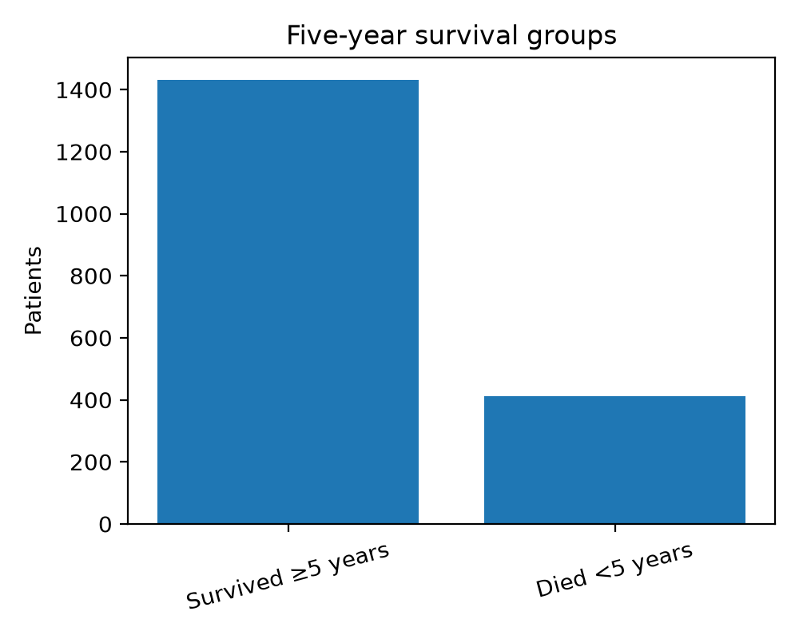
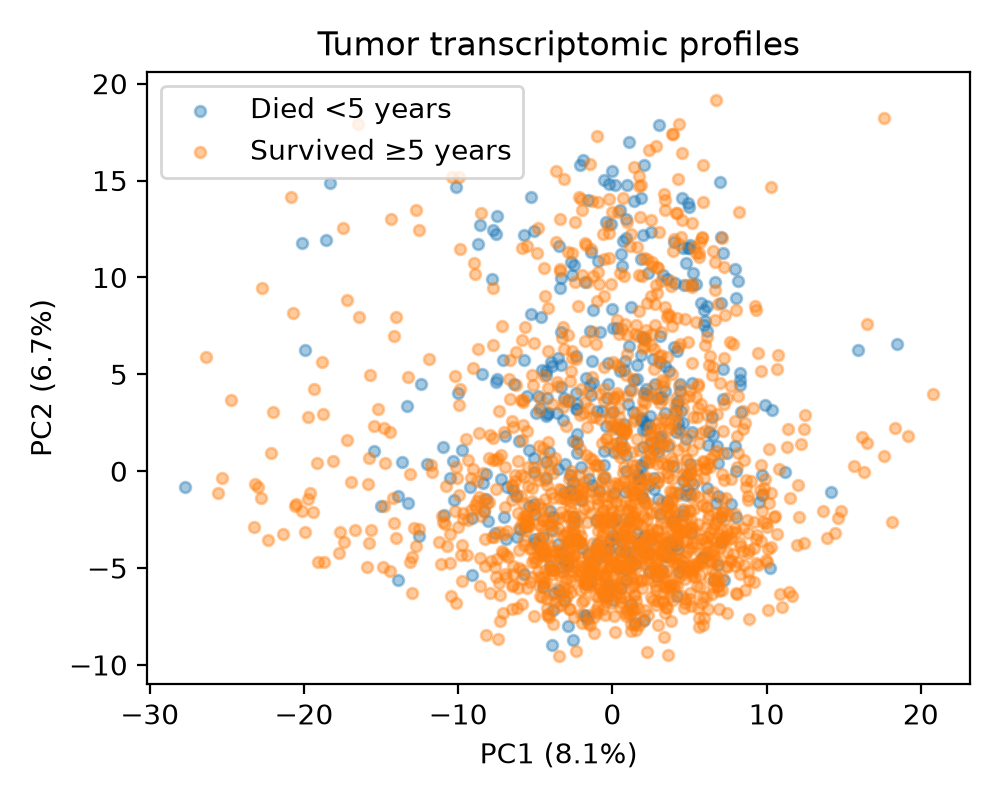
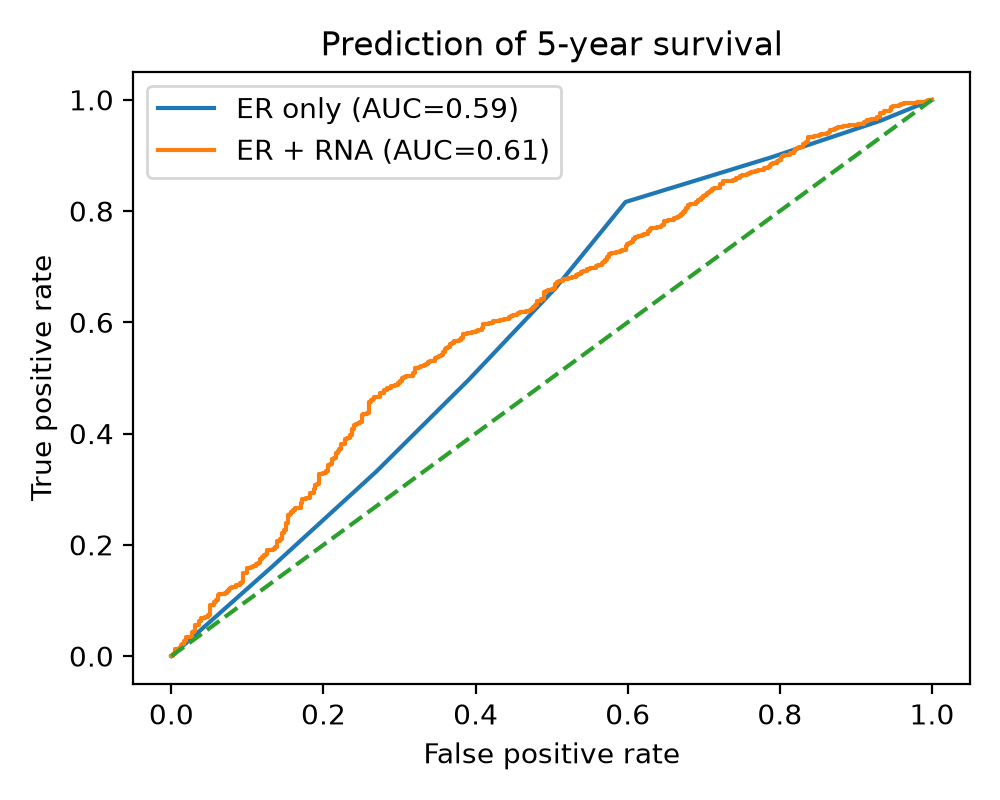

# METABRIC Transcriptomics and 5-Year Survival

## Introduction

Breast cancer outcomes are influenced by tumor molecular characteristics, including estrogen receptor (ER) status. However, broader tumor transcriptomic profiles may contain additional information related to patient outcomes.

Hypothesis: Do tumor transcriptomic profiles improve prediction of 5-year survival beyond ER status alone?

I hypothesized that adding RNA-expression profiles to ER status would improve prediction of whether a patient survived at least five years after diagnosis.

## Results

Patients were divided into two groups based on known 5-year survival outcome. Patients who were alive but had less than five years of follow-up were excluded because their 5-year survival outcome was unknown.

A total of 1,844 patients were included in the analysis. Of these, 1,432 survived at least five years**, while 412 died within five years.

### Five-year survival groups



Principal component analysis (PCA) was used to visualize variation across the tumor RNA-expression profiles. The first two principal components did not show a strong visual separation between the two survival groups.

### Transcriptomic PCA



Two logistic regression models were then compared using 5-fold stratified cross-validation. The first model used ER status alone, while the second model used ER status together with tumor RNA-expression measurements.

The ER-only model produced an AUROC of approximately 0.59, while the ER + transcriptome model produced an AUROC of approximately 0.61.

### Classification performance



Overall, including tumor transcriptomic information modestly improved prediction of 5-year survival compared with ER status alone. However, the overall predictive performance remained limited, suggesting that RNA-expression profiles and ER status alone are not sufficient to accurately predict survival in this dataset.

## Methods

The METABRIC breast cancer dataset was analyzed using Python.

The following software libraries were used:

- **pandas** for reading and organizing the dataset
- **NumPy** for numerical operations
- **scikit-learn** for PCA, logistic regression, cross-validation, feature scaling, and ROC analysis
- **matplotlib** for visualization

Five-year survival was defined as survival for at least 60 months following diagnosis. Patients who died before 60 months were classified as not surviving five years. Patients who were still alive but had less than 60 months of follow-up were excluded because their 5-year outcome was unknown.

RNA-expression measurements were extracted from the gene-expression portion of the METABRIC dataset.

PCA was performed after standardizing the RNA-expression features.

For classification, two logistic regression models were compared:

1. ER status alone
2. ER status plus RNA-expression features

Model performance was assessed using 5-fold stratified cross-validation and area under the receiver operating characteristic curve (AUROC).

### Reproducing the analysis

From the root directory of the repository, run:

```bash
python src/survival_analysis.py
```

The script reads:

```text
data/METABRIC_RNA_Mutation.csv
```

and generates:

```text
results/survival_counts.png
results/survival_pca.png
results/survival_roc.png
```